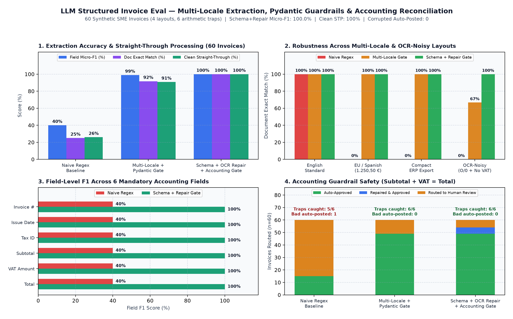

# LLM Structured Invoice Eval

**Structured SME invoice extraction benchmark with Pydantic v2 contracts, multi-locale EU/US number normalization, deterministic OCR/VAT self-repair, accounting reconciliation guardrails (`subtotal + VAT = total`), and an optional local Ollama JSON-mode adapter.**

Automating accounts-payable workflows in SMEs frequently fails on real documents: Spanish/EU decimals (`1.250,50 €`) collide with US exports (`1,250.50 EUR`), scanned invoices introduce OCR digit swaps (`O` vs `0`) or omit explicit VAT amount lines, and unconstrained extractors silently post corrupted totals into ERPs. **LLM Structured Invoice Eval** benchmarks three extraction pipelines quantitatively across **60 synthetic multi-layout SME invoices** (including **6 injected arithmetic-mismatch traps**), measuring field-level Precision/Recall/F1, document exact match, safe straight-through processing (STP), and zero-leakage accounting trap interception—100% reproducible offline with an optional local **Ollama** adapter.



---

## Quickstart (Run Locally in 30 Seconds — No API Key Required)

```bash
git clone https://github.com/xx636xx/llm-structured-invoice-eval.git
cd llm-structured-invoice-eval

python -m venv .venv
# Windows (PowerShell): .venv\Scripts\Activate.ps1
# macOS / Linux:        source .venv/bin/activate

pip install -e ".[dev]"

# 1. Run the 60-invoice multi-layout benchmark and regenerate the overview chart
python -m invoice_eval.cli eval

# 2. Inspect deterministic repair on an OCR invoice missing its printed VAT amount (DOC-003)
python -m invoice_eval.cli parse-sample --doc-index 2

# 3. Inspect automatic interception of an accounting-mismatch trap (DOC-008)
python -m invoice_eval.cli parse-sample --doc-index 7

# 4. Run the automated test suite
python -m pytest -v
```

Optional local LLM extraction via **Ollama** (JSON schema mode wrapped in the exact same Pydantic accounting guardrail):

```bash
python -m invoice_eval.cli parse-sample --doc-index 0 --ollama-model qwen2.5:7b
```

---

## Verified Benchmark Results (60 Multi-Layout SME Invoices, 6 Accounting Error Traps)

| Pipeline | Field Micro-F1 | Doc Exact Match | OCR-Noisy Exact Match | Clean Straight-Through (STP) | Accounting Traps Caught | Corrupted Auto-Posted |
| :--- | :---: | :---: | :---: | :---: | :---: | :---: |
| **Naive Regex Baseline** | 40.0% | 25.0% | 0.0% | 25.9% | 5 / 6 | **1 (leaked)** |
| **Multi-Locale + Pydantic Gate** | 98.9% | 91.7% | 66.7% | 90.7% | **6 / 6** | **0** |
| **Schema + OCR Repair + Accounting Gate** | **100.0%** | **100.0%** | **100.0%** | **100.0%** | **6 / 6** | **0** |

- **Zero corrupted ERP auto-postings:** Both guardrail pipelines intercepted **6/6** injected `subtotal + VAT != total` discrepancies (`NEEDS_HUMAN_REVIEW`), whereas the naive baseline auto-approved a broken English-layout invoice.
- **Deterministic self-consistency repair:** Recovering OCR `O → 0` digit swaps and inferring omitted VAT lines *only* when `subtotal × (1 + vat_rate) == total` (within €0.02) lifted OCR-noisy exact match from **66.7% → 100.0%** and clean straight-through processing from **90.7% → 100.0%** (`49 AUTO_APPROVED`, `5 REPAIRED_AND_APPROVED`, `6 NEEDS_HUMAN_REVIEW`).

---

## Sample Guardrail Outputs (`invoice_eval.cli parse-sample`)

### 1. Deterministic VAT Recovery (`DOC-003` — OCR invoice with omitted VAT line)
```json
{
  "doc_id": "DOC-003",
  "pipeline": "schema_repair_guardrails",
  "invoice_number": "FAC-2026-1042",
  "issue_date": "2026-01-09",
  "supplier_tax_id": "B08394812",
  "subtotal": 4159.54,
  "vat_rate_pct": 21.0,
  "vat_amount": 873.5,
  "total": 5033.04,
  "reconciliation_status": "REPAIRED_AND_APPROVED",
  "repairs_applied": ["INFERRED_MISSING_VAT_AMOUNT=873.50"]
}
```

### 2. Arithmetic Discrepancy Intercepted (`DOC-008` — printed total off by €45.00)
```json
{
  "doc_id": "DOC-008",
  "pipeline": "schema_repair_guardrails",
  "invoice_number": "INV-2026-2047",
  "subtotal": 1694.61,
  "vat_amount": 67.78,
  "total": 1807.39,
  "reconciliation_status": "NEEDS_HUMAN_REVIEW",
  "validation_errors": [
    "ACCOUNTING_MISMATCH: subtotal(1694.61) + vat(67.78) = 1762.39 != total(1807.39)"
  ]
}
```

---

## Project Structure

```text
llm-structured-invoice-eval/
├── assets/
│   └── invoice_eval_overview.png    # 4-panel verified benchmark dashboard
├── src/invoice_eval/
│   ├── generator.py                 # 60 synthetic EU/US/OCR/ERP invoices + 6 arithmetic traps
│   ├── extractors.py                # Naive regex, multi-locale Pydantic gate, repair pipeline & Ollama adapter
│   ├── evaluator.py                 # Field-level P/R/F1, layout exact match & guardrail safety metrics
│   ├── schemas.py                   # Pydantic v2 invoice & validation models
│   ├── plotting.py                  # Matplotlib 4-panel dashboard renderer
│   └── cli.py                       # `eval` and `parse-sample` CLI
└── tests/
    └── test_invoice_eval.py         # Multi-locale parsing, trap safety & benchmark assertions
```

## Author

**Alejandro Montejo de Luna**

## License

MIT — see [LICENSE](LICENSE).
